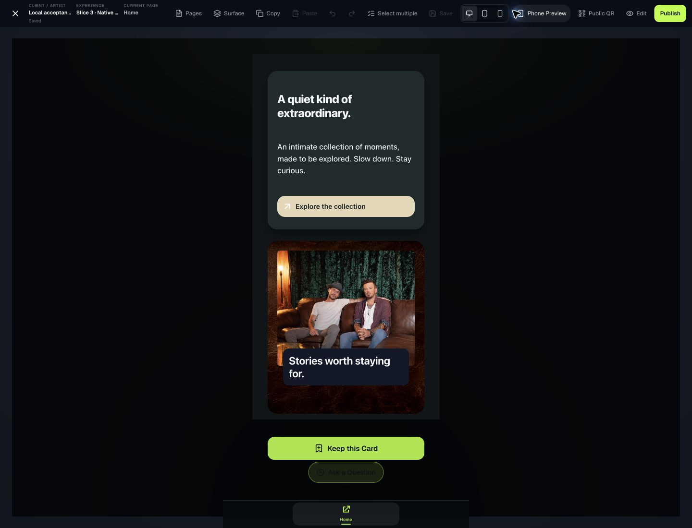

# Slice 3 — Native Surface/Container authoring handoff

Date: October 24, 2026. **Candidate for Product Owner hands-on review; not release certification or Product Owner acceptance.**

## Scope and checkpoints

Repository: `TapMagic/Tap-Connect-Studio`. Root: `/Users/rcs/Development/tap-connect-studio`. Development branch: `codex/studio-reconstitution-slice-1`.

- Approved planning baseline: `3797f717f0d2637d898cf60789c36febd1425561`.
- 3.0 Start-Document Truth: [`3fac3a8cc922384b468dffd31290a98c991a5988`](https://github.com/TapMagic/Tap-Connect-Studio/commit/3fac3a8cc922384b468dffd31290a98c991a5988). [Checkpoint](SLICE3_START_DOCUMENT_TRUTH_CHECKPOINT_2026-10-23.md).
- 3.1 Surface Styling and Contextual Tasks: [`65bf47da30c49d8a0f43d5c24319507cc3fc76bd`](https://github.com/TapMagic/Tap-Connect-Studio/commit/65bf47da30c49d8a0f43d5c24319507cc3fc76bd). [Checkpoint](SLICE3_SURFACE_TASKS_CHECKPOINT_2026-10-24.md).
- 3.2 completion: the commit containing this handoff; exact final commit and remote verification returned with the delivery. [Source manifest](proofs/slice3-native-2026-10-23/55-intended-source-manifest.json) pins the tested intended source independently of documentation commits.

No new schema, geometry, Material, clipboard, pointer, keyboard, task, history, or rendering engine. No deployment, production mutation, main merge, migration, or business-domain/AI implementation.

## Corrections and shared authorities

| Demonstrated cause | Correction |
| --- | --- |
| Canonical cloning passed through a legacy default-page projection, allowing an empty projection to erase canonical composition | Canonical/legacy boundary is idempotent and only applies a real legacy projection; canonical cloning preserves populated and intentionally empty pages and internal references |
| Native creation assumed an existing source Card | Existing creation endpoint and Library support explicit Blank or Clone; Blank uses existing canonical default-page helpers and native first insertion |
| Root Material selection changed frame mode; stale Container fill mirrors and whole-state normalization changed unrelated properties | Shared Surface adapter reads effective state, patches only the chosen field, clears conflicting fill mirrors, and preserves unrelated geometry/parameters |
| Source-backed recipes used an obsolete visual-plane shape and retained stale parameter mirrors after glass | Use canonical photography Visual Plane; applied recipe props and effective Inspector mirrors now agree |
| Appearance, outer placement, and internal layout competed in one long Inspector | Existing task authority exposes root Surface/Layout and Container Surface/Placement/Contents, with direct contextual and phone access |
| Clipping and rich shadows differed between editing and Preview | Existing composition renderer clips the content plane in both modes and uses shared shadow projection, leaving manipulation controls outside the clipping plane |
| Inserted image aspect lock lacked a native release control | Existing image Inspector now exposes canonical aspect lock; unlocking offers Cover in a freely sized frame, with one history command |
| At 390px, Preview return could be outside the horizontally overflowing header | Visible 44px-high Back to editing control uses the existing Preview/task exit; no document change |

## Exact source files

- `app/api/experiences/route.ts` — Blank/Clone POST behavior only; unrelated GET work remains uncommitted.
- `components/fusion/card/experience-library.tsx` — native Blank/Clone dialog; unrelated family-tab WIP remains uncommitted.
- `lib/fusion/card/experience-pages.ts` — canonical Blank and clone/projection truth.
- `lib/fusion/card/__tests__/experience-pages.test.ts` — clone, empty-page, Blank and first-insertion regressions.
- `lib/fusion/creative-studio/material-engine.ts` — fill reconciliation, canonical photographic recipes and parameter agreement.
- `lib/fusion/creative-studio/platform/surface-capability.ts` — effective Surface state and isolated field patches.
- `lib/fusion/creative-studio/__tests__/surface-authoring-truth.test.ts` — six focused adapter/renderer regressions.
- `components/fusion/card/reconstitution/studio-surface-materials.tsx` — shared chooser presentation consuming existing recipes/rendering.
- `components/fusion/card/reconstitution/studio-card-surface-inspector.tsx` — root Surface/Layout tasks.
- `components/fusion/card/reconstitution/studio-composition-inspector.tsx` — Container tasks and native image aspect control.
- `components/fusion/card/reconstitution/card-studio-reconstitution-workspace.tsx` — contextual task routing and phone Preview return.
- `components/fusion/creative-studio/creative-composition-canvas.tsx` — shared clipping/shadow rendering.
- `docs/product-reconstitution/creative-studio-platform/proofs/slice3-readiness-2026-10-23/authority-probes.ts` — required root-label type correction in the existing readiness probe.

## Native fixture and walkthrough

[Open primary local fixture](http://127.0.0.1:3050/dashboard/card/edit?experience=cmvlvb1b502e7to9k6hzzalc4&returnTo=%2Fdashboard%2Fexperiences%2Flibrary).

[Open Flow-root / clipboard companion](http://127.0.0.1:3050/dashboard/card/edit?experience=cmvlw4h0l07ffto9k723tgcsu&returnTo=%2Fdashboard%2Fexperiences%2Flibrary).

The primary was created through Library → New Experience → Blank, then populated entirely through native controls. No JSON seeding or database writes were used to construct the composition. An existing approved image asset was reused without modifying its source or a production Experience.

1. Root Surface: dark solid, then native Flow → Layered; final plane 738px, explicit minimum 762px. Material selection separately proved preservation of Inset mode before the final design used full bleed.
2. Container A: native insertion, Flow contents, padding 20px, 326×330px, root x20/y24. Independently edited heading, body and cream Button. Button destination is the local Library for safe functional testing.
3. Container B: native insertion, Layered contents, padding 20px, 326×360px, root x20/y378. Applied Worn Saddle Leather through the shared Material chooser; replaced the image using native asset controls, unlocked its frame, set Cover at 286×240px, and added a separately editable overlay Text box.
4. Select through Canvas or Outline. Surface changes appearance; Placement changes the Container in its parent; Contents changes its children’s layout. For nested text, select the child in Outline, then use its canvas Edit text affordance or Inspector. Generic duplicate Text labels and entering nested selection remain discoverability friction.
5. Drag B from its exposed padding, resize its right edge, enter exact Inspector dimensions, rotate, Undo/Redo, Save and reload. Use the companion for destructive experiments without altering the main visual candidate.
6. Preview verifies the same composition; the Button opens the local Library. At 390px, bottom tools remain available and Preview provides Back to editing.

## Measured interaction evidence

These are observed native operations, not API-only assertions. Screenshots are in [the evidence directory](proofs/slice3-native-2026-10-23/).

| Operation | Observed result / evidence |
| --- | --- |
| Blank, first Text, first Container, Clone | Native dialogs, empty root, first insertion, undo restoration and reloaded previews: 01–06; 3.0 trace |
| Material and parameter isolation | Root Material kept Inset; Container radius28/opacity80/border3; Undo border1, Redo3; Material→Solid→Gradient; 31–36 |
| Body drag at 75% zoom | B x20/y378 → x29.28/y369 with snapping; 41 before / 42 after |
| Arrow then Shift+Arrow | First movement1px; larger request constrained at parent right boundary, effective9.72px. Separate modifier transactions undone, then drag undone. This is not evidence of an unconstrained11px move |
| Right edge resize | B width326→346, height360 unchanged, x20/y378 unchanged; Image physical width286 preserved (100% of286 → 93.4641% of306); Inspector matched346×360; Undo restored. Evidence43 |
| Rotation | Inspector8°, visible rotated frame; Undo/Redo/Undo restored; evidence44 |
| Four layout combinations | Primary Layered root with Flow A/Layered B; native clone switched to Flow root with Flow A/Layered B; Preview evidence45 |
| Alignment and Group | B Image+Text multi-selection; Align Left changed Text x to0; Undo restored; native Group creation |
| Copy/paste Group | Copy selected Group, select explicit B destination, Paste; two new nodes. Undo removed both; Redo restored the same new IDs; Undo removed test copy; evidence46 |
| Nested placement and Material | Added native nested Container in B, applied Gunmetal, checked Placement parent326×360 and hierarchy; Undo removed temporary nested test; evidence47 |
| Clipping | B Contents Clip + region180px; Edit and Preview both overflow:hidden/padding0/height180/radius20; lower overlay clipped. Undo restored360/unclipped; 48–49 |
| Duplicate/delete identity | Native duplicate of A Button; Delete removed duplicate; Undo restored its same ID; Undo removed test duplicate |
| Fit to content | Plane900→738; explicit minimum762 remains separate; children retained physical geometry |
| Phone tasks | Surface/Placement/Contents tabs measured122×44px; evidence35 |
| Phone Preview return | At390×844, button133.68×44px atx244.32/y790.5, inside viewport; native click restored editing; 50 before /51 after |
| Phone text controls | Inspector field and canvas Edit text entered native textbox; arrow input retained field ownership, Escape/Cancel exited without changing saved content or geometry; 52–53. No physical phone keyboard or IME certification implied |
| Persistence | Primary revision36 and companion13 reopened/saved, publicationActive=false; read-only local snapshot and hashes in55-saved-fixtures.json |

No timed novice study was performed. No percentage improvement or task-speed estimate is presented as measured evidence. Automation attempts before hydration had no effect; the operation was retried only after state showed the correct document. Initial double-clicks on nested text selected its Container; Outline plus Edit text completed the operation. An initial viewport override affected the companion tab; those observations were not counted as primary390px evidence. Closing the saved companion and checking actual DOM viewport established390×844 before final captures. The browser screenshot path initially produced scaled/cropped phone images; evidence51–53 was replaced with verified native screenshots rather than counted as valid visual evidence.

## Verification and reproducibility

- Working-tree focused/broader Studio + Card suite: **677/677 passed** ([log](proofs/slice3-native-2026-10-23/55-working-tests.txt)). Two tests belong to preserved unrelated WIP.
- Isolated intended-source export, excluding WIP and local environment files: **674 passed, 1 failed, 675 total** ([log](proofs/slice3-native-2026-10-23/55-clean-tests.txt)). The failure is the existing Cabinet Noir original-handoff dependency: missing `tmp/Cabinet Noir v1/Cabinet_Noir_Cody_Handoff/01_PRODUCTION_ASSETS/CN-001_identity-topper-brand-crest.png`. Integrity checks were not weakened.
- Final isolated production webpack build: **passed**, including TypeScript and static generation ([log](proofs/slice3-native-2026-10-23/55-clean-build.txt)). Network access was needed for build-time fonts. No deployment occurred.
- Commands: `node --import tsx --test lib/fusion/creative-studio/__tests__/*.test.ts lib/fusion/card/__tests__/*.test.ts`; `npm run build -- --webpack`. Build targeted the verified local development database. Do not reuse production connection settings.
- Export was made from3.1 plus the four intended3.2 source files. Dependencies were supplied from the installed workspace; this verifies source isolation, not a fresh package installation or independent machine.
- Local fixture data/assets are not packaged as a new seeding subsystem. A clean checkout needs normal local configuration and existing local acceptance data, or the documented native Blank journey.
-36 unrelated tracked/untracked WIP checks preserved; shared-file residual added/removed lines compared with the initial patch. [Manifest](proofs/slice3-native-2026-10-23/55-wip-preservation.json).
- Accepted Slice1 remains revision49/hash44a7a26d…; accepted Slice2 remains revision69/hash96f1d311…; exact hashes unchanged in the saved-fixture snapshot.
- Love & Theft production was not changed or reverified. Its previously verified functional baseline remains protected; production hash verification remains **BLOCKED**, not passed.

## Limitations and readiness assessment

**Ready for bounded Product Owner review of native authoring; not ready for release certification.** The canonical model and task separation held without new authorities. Styling, geometry and content remain editable through existing commands/history. Future tApIt remains a consumer of these same capabilities; no AI scope added.

Open gates and friction:

- Exact reference-image fidelity **BLOCKED**: original reference not received. The shown composition is an independently designed candidate, not an exact-match claim.
- Visual quality and novice usability require Product Owner judgment. Current review finds the composition coherent and editable; automation does not establish customer ease or approval.
- Physical touch, mobile OS keyboard/IME, Safari/cross-browser, signed Live Device and public-runtime end-to-end verification were not completed here. Preview parity is verified; unchanged shared render paths do not substitute for those runtime checks.
- Nested child selection can require Outline; repeated generic Text names are ambiguous. No claim that one double-click always enters nested text editing.
- Root-close/task return can restore earlier selection; watch the visible breadcrumb before styling a new target.
- Imported rich shadow strings render through the shared authority, but the simple numeric shadow control cannot fully describe every compound shadow. Existing advanced treatment remains preserved until edited.
- Chrome logged a background/backgroundSize shorthand warning during transitions. Observed final Edit/Preview output matched; this is a remaining renderer cleanup risk, not a failing screenshot comparison disguised as passing.
- Group creation, clipboard identity and undo were verified. Exact Group displacement from the attempted Y control was not independently measured; no precise Group-movement claim is made.
- Cabinet Noir clean-checkout dependency remains a release blocker. Minimal separate recommendation: approve a provenance-preserving artifact retrieval/package step for the original certified files, keyed by the existing manifest hashes; then rerun unchanged integrity tests. Do not regenerate replacements or authorize V0 packaging through this slice.

Recommended next step: Product Owner hands-on review using both fixtures, then a separately scoped nested-selection/discovery refinement if the observed friction is unacceptable. For a formative novice check, have three new users independently create Blank → two Containers → image/text/button → style → resize → Preview; record completion, wrong-target edits, requests for help and panel switches. No results are invented in advance. Preserve the reference, physical-device and Cabinet Noir gates before release.

## Review workflow and synchronized architecture documents

Continue: local development → automated verification → documentation/evidence → development-branch push → independent architecture/product review → Product Owner acceptance → separately authorized staging/release.

The following previously requested documents were independently fetched from GitHub at3.1 and their Git blob hashes matched the intended local versions; final synchronization is rechecked at delivery:

| Document | Immutable GitHub version |
| --- | --- |
| UX architecture proposal | [STUDIO_UX_ARCHITECTURE_PROPOSAL_2026-10-22.md](https://github.com/TapMagic/Tap-Connect-Studio/blob/65bf47da30c49d8a0f43d5c24319507cc3fc76bd/docs/product-reconstitution/creative-studio-platform/STUDIO_UX_ARCHITECTURE_PROPOSAL_2026-10-22.md) |
| Surface authoring audit | [STUDIO_SURFACE_AUTHORING_AUDIT_2026-10-22.md](https://github.com/TapMagic/Tap-Connect-Studio/blob/65bf47da30c49d8a0f43d5c24319507cc3fc76bd/docs/product-reconstitution/creative-studio-platform/STUDIO_SURFACE_AUTHORING_AUDIT_2026-10-22.md) |
| Workflow decisions | [STUDIO_UX_WORKFLOW_DECISIONS_2026-10-22.md](https://github.com/TapMagic/Tap-Connect-Studio/blob/65bf47da30c49d8a0f43d5c24319507cc3fc76bd/docs/product-reconstitution/creative-studio-platform/STUDIO_UX_WORKFLOW_DECISIONS_2026-10-22.md) |
| Native visual acceptance | [STUDIO_NATIVE_VISUAL_ACCEPTANCE_2026-10-22.md](https://github.com/TapMagic/Tap-Connect-Studio/blob/65bf47da30c49d8a0f43d5c24319507cc3fc76bd/docs/product-reconstitution/creative-studio-platform/STUDIO_NATIVE_VISUAL_ACCEPTANCE_2026-10-22.md) |
| Implementation prompt | [STUDIO_UX_IMPLEMENTATION_PROMPT_2026-10-22.md](https://github.com/TapMagic/Tap-Connect-Studio/blob/65bf47da30c49d8a0f43d5c24319507cc3fc76bd/docs/product-reconstitution/creative-studio-platform/STUDIO_UX_IMPLEMENTATION_PROMPT_2026-10-22.md) |
