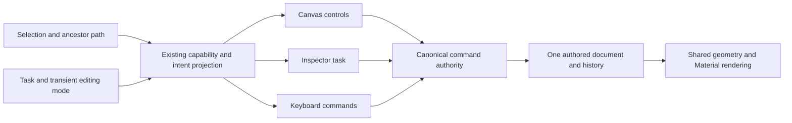
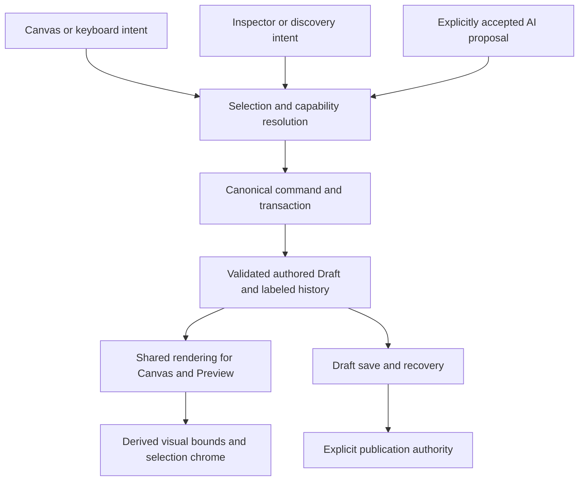

# TapConnect Studio UX architecture proposal

Prepared for Rich, Product Owner. Investigation: October 22, 2026 ET, October 23 UTC. Revised against the October 22 Master UX, Visual Authoring & Interaction Architecture Directive. Status: **planning direction provisionally approved; Select and Resize with Confidence approved for local implementation only; Slice 1 hands-on acceptance remains open**.

Studio should make the Experience Surface and its independently styled Containers the visible foundation of authoring. Selection, task intent, editing mode and declared capabilities should determine the relevant controls. Today, too much of the interface follows the shape of the implementation: generic Module inspectors, competing layout controls, provider tabs, and technical explanations precede ordinary editing. The recommendation is to make the existing shared authorities determine the interface consistently, then deliver complete workflows in small increments.

The desired first experience is concrete: choose a credible starting design, replace its words and imagery, set a useful action, check the phone experience, and publish deliberately. A customer should not need to understand normalized geometry, parent authority, resource providers, or publication internals to do this.

Companions: [twelve workflows × fourteen revised questions](STUDIO_UX_WORKFLOW_DECISIONS_2026-10-22.md), [Surface capability audit, research and effort assessment](STUDIO_SURFACE_AUTHORING_AUDIT_2026-10-22.md), [permanent native visual acceptance specification](STUDIO_NATIVE_VISUAL_ACCEPTANCE_2026-10-22.md), and [implementation prompt](STUDIO_UX_IMPLEMENTATION_PROMPT_2026-10-22.md). This revision supersedes the earlier proposal’s sequencing and authorization language.

## Recommendation for review

The Surface-first direction is provisionally approved for architectural planning. Local implementation is authorized only for Select and Resize with Confidence; later increments remain gated. The [revised implementation prompt](STUDIO_UX_IMPLEMENTATION_PROMPT_2026-10-22.md) defines **Select and resize with confidence** as the smallest proposed corrective candidate within open Slice 1; it pairs shared resize correctness with clear selection, smaller handles, discoverable Position controls and truthful parent-governed sizing. This candidate cannot close Slice 1 or activate Slice 2 by itself.

Make the root Surface a first-class selection and let Containers carry independent appearance and inner layout. Fix trust in manipulation first, then Text truth, then prove a polished native two-Container journey before broadening discovery and onboarding. The largest newly identified risk is not lack of Material technology: it is disagreement between current style representations and control applicability.

The approved immediate implementation scope is Select and Resize with Confidence within Slice 1. This approval does not extend to the full later plan. The full plan preserves the conditional S2 gate and classifies later work separately. Missing original visual reference and fresh measured task counts remain explicit evidence gaps.

## Evidence and approval boundaries

The audit inspected the local running editor at `http://127.0.0.1:3050/dashboard/card/edit`, the Experience Library and creation form, Add/Text discovery, Canvas and Outline selection, Text/Image/Surface inspectors, font browsing, media replacement, Preview, and the editor at 390 × 844. Desktop screenshots use the existing 1200 × 621 browser viewport. This is a heuristic evaluation of the current working tree, not a new-customer usability study or a production audit.

The running tree contains unfinished Slice 1 corrective changes and unrelated pre-existing work. Its last focused corrective test run reported **35 passed, 2 failed**: nested geometry unit round-trip and a source-based handle reachability assertion. Those results were read from the existing log, not rerun for this proposal. The new geometry and handle changes are therefore not a certified baseline. Slice 1 is **NOT ACCEPTED**. Slice 2 remains conditionally approved and gated on Rich's explicit Slice 1 hands-on acceptance.

No application source was edited during this proposal pass. No production operation, publication, Access change, credential change, QR action, or AI generation was performed. During local Material inspection, clicking the Worn Saddle Leather card applied a preset rather than opening browsing. Undo restored the previous solid background and the editor returned to Saved. Local draft revision history may have advanced; this audit does not claim a byte-identical untouched fixture. Further mutation tests should use an independent local clone.

The prior local solid background and Saved state were also confirmed after reload; image 11 records that check. No claim of full fixture hash equality is made.

The previously accepted Love & Theft functional baseline remains the reference: Draft 1896, Published 21, active publication, Access ON, permanent active QR, stable destination. **Hash verification remains BLOCKED.** No additional production authentication or hash investigation is proposed.

The [Product Steward Constitution](PRODUCT_STEWARD_CONSTITUTION.md) and [binding interaction specification](STUDIO_RECONSTITUTION_INTERACTION_SPEC.md) govern this proposal. The October 20 consolidation blueprint and decision sheet are planning inputs, not evidence that every proposed product choice was approved. The supplied master directive ends at section 14, “Professional visual authoring.” No further text or reference image was attached. The plan covers the supplied requirements and proposes the remaining strategy; exact reference-image comparison is BLOCKED. Chrome became unavailable during the follow-up audit; the prior screenshots remain the observed UI evidence. New Surface findings are source evidence, not fresh interaction tests.

## Current state and priority

Evidence labels: **observed** means inspected in the running local UI; **source** means verified in implementation; **risk** means a plausible failure requiring a dedicated reproduction. Priorities express user harm and dependency, not an implementation schedule.

| Priority | Finding and user consequence | Evidence | Recommended disposition |
| --- | --- | --- | --- |
| P0 | Geometry and selection remain unaccepted. A person cannot confidently manipulate what is selected. | PO findings; unfinished correction; two failing focused checks. | Finish the bounded Slice 1 correction and obtain hands-on acceptance before dependent work. |
| P0 | A Layered Text/Image Inspector also exposes **Position · Flow placement**, including a second Width control. Users cannot tell which value governs the result. | Observed; `studio-composition-inspector.tsx:169–195` conditionally adds Layered controls but unconditionally appends Flow controls. | Resolve applicable controls from parent layout and capability once. Preserve inactive values without presenting them as active controls. |
| P0 | Edit Text opens with geometry, constraints and diagnostics; the text field is below the initial view. On phone, the sheet conceals most of the object and still leads with geometry. | Observed, images 03 and 05. Current corrections add technically honest but excessive explanation. | Content first for Edit; Position opens the same Inspector at geometry. Move diagnostics into an explicit advanced view. |
| P1 | Five of seven rail destinations are disabled, including Text and Assets, despite related working paths elsewhere. The product advertises dead ends and hides viable ones. | Observed; `studio-rail-registry.ts:20`. | Expose ready tasks through shared adapters. Hide genuinely deferred destinations from ordinary customer navigation. |
| P1 | Opening Add consumes almost half the desktop viewport, while the page extends past the remaining canvas's right edge. Users lose the destination they are browsing for. | Observed, image 02 at 1200px. | Preserve the insertion target and fit/scroll context when opening discovery; use the existing adaptive task geometry rather than a fixed wide drawer. |
| P1 | New Experience asks for Client/Artist, Type and Source/template, defaulting to Current main Card. The form favors administrative cloning over starting a useful design. | Observed, image 10; `experience-library.tsx:181`. | Start with visual starting points and a clear Blank option; derive workspace context and move classification to Details. Preserve explicit Clone. |
| P1 | At desktop width, Client, Experience and Page names truncate into fragments. At 390px, identity is absent from the visible header and lifecycle controls run beyond its initial view. | Observed, images 01 and 04. | Give the Experience name and save status priority; keep Page selection adjacent to canvas navigation; move infrequent commands to a named menu. |
| P1 | Desktop/tablet/phone controls can imply distinct authored layouts, while Studio uses a 390px surface and runtime is capped at 512px. | Observed desktop selection with phone-shaped canvas; source `card-viewport-surface.tsx`, builder preview wrapper, shell `canvasMaxWidth`. | Label these as preview contexts until actual responsive authoring exists. Never equate editor window width with output width. |
| P1 | Image editing exposes tint before source replacement and Fit; replacement opens a large modal with Pexels/Logo.dev configuration states. | Observed, images 06–07; shared browser source. | Image selection leads with Replace, Crop/Focal and Fit. Present user jobs such as Photos and Logos; retain provider provenance in details. Reuse the browser in the shared task surface. |
| P1 | The shell needs more truthful save-failure behavior. The catch message says “retrying,” while the autosave effect stops when `saveFailed` is true. | Source, `tap-card-builder.tsx:2052–2122`; failure was not induced. | Say “Not saved — Retry” until an actual retry runs. Keep conflict review and recoverable local work explicit. |
| P1 | Generic labels hide meaning: Text and Image both become “Module”; inherited/custom color explanations can appear simultaneously; geometry diagnostics discuss storage internals. | Observed; images 03, 05, 06; color provenance projections. | Name the selected object and property destination. Resolve value provenance once. Put implementation terminology in diagnostics. |
| P1 | Mobile editing is a rearranged desktop property list. The bottom tool dock competes with the sheet, and ordinary content controls start far below its header. | Observed at 390px; physical keyboard, IME and touch behavior not tested here. | Task-specific sheet, visible selected-object identity, keyboard-aware layout, and explicit precision access. Require physical phone acceptance. |
| P2 | Font discovery has useful canonical recents and recommendations, but the initial list is capped and search returns at most 18 choices with no visible browse-all path. Weight is an unrestricted-looking numeric control despite catalog variant metadata. | Observed browse surface; source font selection and catalog. | Preserve real recents. Add progressive browse/filter depth and only valid family variants; show font loading/fallback state. |
| P2 | Surface Materials currently presents one Leather choice in this inspector; its click immediately applies several properties. This is not a broad Material browser. | Observed and source `studio-card-surface-inspector.tsx:316`. | A small excellent set is acceptable. Label “Apply …”, show destination and applied preview, and expose a real browse path only when its catalog is ready. |
| P2 | “Phone readability: Pass” is based on a font-size threshold. It does not prove fit, contrast, clipping, or real device readability. | Source `text-authoring.ts:evaluateStudioTextAccessibility`; observed status. | Label the result “Font size check”; keep fit, contrast and content completeness as separate checks. |
| P2 | tApIt-branded operations include deterministic preset application and search filtering. These are useful, but do not establish generative assistance readiness. | Source `studio-selection-inspector.tsx` and `studio-icon-discovery.tsx`; no provider request executed. | Describe the actual result, distinguish ready automation from generation, and use canonical proposals for future AI changes. |
| Investigate | One canvas click targeting Nested Text ended with Map selected; Outline selected Nested Text correctly. Crowding/overlap or event targeting may be involved. | Single local observation, not an isolated reproduction. | Reproduce on a clone before attributing a new selection-engine defect. Include overlapping-object selection in acceptance. |

Positive foundations should be preserved: canonical command/history paths, selection references, group/parent authorities, immutable publication separation, recovery journal, shared media provenance, server-backed font activity, capability declarations, shared rendering, and an existing task return stack. This is a substantial base for incremental improvement.

## Lessons from documented creative workflows

The following are documented patterns, not claims of independent hands-on testing of competitors. Their application to TapConnect is design judgment.

| Source | Documented pattern | Application to Studio |
| --- | --- | --- |
| [Canva grouping and layering](https://www.canva.com/help/layer-group-align/) | Selection leads to contextual Group/Position actions; editing a member can preserve the group. | Keep common commands at selection and provide an explicit group-content scope. Do not flatten or reparent to make editing easier. |
| [Canva resize and crop](https://www.canva.com/en_gb/help/resize-and-crop/) | Resize and crop have different jobs; precise dimensions live under advanced positioning; double-click can enter crop. | Name the distinction between frame and image content. Offer a direct crop action and exact values together with visible constraints. |
| [Figma text](https://help.figma.com/hc/en-us/articles/360039956434-Guide-to-text-in-Figma-Design) | Text creation and resizing behavior are explicit, and text content is distinguished from type properties. | Make caret editing deliberate; separate exact source content, typography and box behavior while retaining one transaction authority. |
| [Figma geometry](https://help.figma.com/hc/en-us/articles/360039956914-Adjust-alignment-rotation-position-and-dimensions) | Alignment depends on selection scope; canvas manipulation and numeric properties coexist. | Show the alignment target and selected scope. Exact controls should refine the same geometry used by handles. |
| [Figma auto layout](https://help.figma.com/hc/en-us/articles/360040451373-Guide-to-auto-layout-in-Figma) | Layout offers content-dependent sizing and explicit fixed/fill behavior. | Explain Flow through visible reflow and content sizing. Preserve Layered as a distinct parent layout; do not transplant Figma semantics wholesale. |
| [Canva mobile navigation](https://www.canva.com/en_gb/help/navigate-canva-mobile-app/) | Creation, template browsing and finding existing work have clear task destinations. | Phone authoring needs its own presentation of the same jobs; shrinking desktop controls is insufficient. This source concerns navigation, not proof of mobile canvas details. |
| [Webflow breakpoints](https://help.webflow.com/hc/en-us/articles/33961300305811-Breakpoints-overview) | It distinguishes inherited styles from values authored at a breakpoint and exposes their origin. | When responsive authoring is approved, show inherited/custom values and reset behavior. Keep content and business identity independent of viewport. |
| [Figma version history](https://help.figma.com/hc/en-us/articles/360038006754-View-a-file-s-version-history) | Earlier versions can be inspected and restored deliberately. | Recovery should let users understand the candidate version before replacing their draft. Draft recovery must not roll back publication implicitly. |
| [Canva Magic Write](https://www.canva.com/en_au/help/use-magic-write/) and [Adobe Express Photos object insertion](https://helpx.adobe.com/uk/express-photos/desktop/edit-images/insert-objects.html) | Scoped text operations offer result choices; image generation offers result review and Keep/Discard. | Use contextual results, cancellation and explicit acceptance. Accepted changes enter the same commands as manual edits. |

## Recommended interaction architecture

### A stable workspace with task driven detail

The lifecycle header shows **Experience name, save state, Undo/Redo, Preview, Publish**. A document menu owns rename, details, history and return to Library. Page navigation sits beside the canvas. View controls show the actual output width and zoom independently. Phone Preview and permanent public QR remain distinct, but need not both consume permanent header space.

The recommended durable creative destinations are **Add, Text, Media, Brand, Layers**. Text is a direct entry to the same discovery adapter available through Add. Whole-Experience templates belong at creation and under Add → Templates; section templates belong under Add → Sections. The Experience Surface is always directly selectable through a named canvas breadcrumb and Layers root; selecting it opens Appearance and its internal Layout. Clicking empty Surface space selects that root context. Page navigation changes the page; it is not a prerequisite for reaching background styling. Layers is the proposed customer label for the current Outline. Page navigation stays outside this creative-job taxonomy.

This changes the October 20 blueprint's proposed overloaded Design destination. It follows the binding specification's findability test rather than optimizing rail count. Ready destinations ship progressively; no empty or disabled navigation is exposed merely to resemble the target. Supported expert commands remain discoverable through menus and, later, a search surface backed by the existing registry.

Use one contextual task surface beside the canvas. At wide widths a discovery drawer and an explicitly opened precision Inspector may coexist if useful canvas space remains. At compact widths they become mutually exclusive presentations of the same task. At phone widths use one bottom sheet. The implementation should extend `adaptive-workspace` and `drawer-controller`, not add a new navigation state machine.

### Surface-first composition and control relevance

The governing projection is **Selection + Task Intent + Editing Mode + Capabilities → Relevant Controls**. Selection includes the actual target, ancestor path, group scope, parent layout and locks. Intent is the current task (Edit, Style, Arrange, Replace, Nest). Editing mode is transient state (selection, caret, crop, drag, preview). Capabilities supply applicability and constraints. None becomes a second document or command store.

The root Surface owns page background and child layout. A Container owns its appearance, content layout, padding and clipping. Its outer position and sizing are governed by its parent. A Group owns a shared selection/transform relationship among eligible siblings; it adds no surface, padding or new parent. Do not turn Group's existing member-arrangement command into Container layout semantics. Rename that command “Arrange members” if retained.

| Parent layout | Container child layout | Visible outer controls | Visible inner controls |
| --- | --- | --- | --- |
| Flow | Flow | Order, fill/content/fixed width where supported, alignment, constraints | Direction, gap, padding, content sizing |
| Flow | Layered | Flow order and sizing; no free x/y | Child x/y, region height, local stacking and bounds |
| Layered | Flow | x/y, W/H and declared rotation/resize policy | Reflow, gap, padding; explicit overflow if contents exceed authored frame |
| Layered | Layered | Outer x/y, W/H and declared rotation/resize policy | Independent child coordinates and local stacking |

The Inspector separates **Placement in [parent]**, **Surface**, and **Contents layout**. Text opens Content, image opens Replace/Crop, root or Container opens Surface. Layout mode changes are explicit conversions with a consequence preview and one undoable commit. Neither adding a Container nor dragging it changes a layout mode automatically.

A compact toolbar names the target (“Container A”, “Group · 3 items”, “Text”). It exposes Style/Edit contents for Containers and Edit contents/Ungroup for Groups, with Arrange and More. Hover outlines are lighter than the active manipulation frame. Parent boundaries may appear as subdued context while editing a child; they never acquire active handles. Keep a persistent breadcrumb to escape deeply nested content.

### Moving, reordering and nesting

Move keeps the same parent. Reorder changes position among siblings. Nest changes parent. Present those as distinct outcomes before release. Existing Flow drop markers already separate destination parent and index; build on them. Existing Layered move/snap should continue moving within its parent.

For a proposed drag-to-nest extension, normal dragging never reparents merely because it overlaps a Container. Enter a labeled “Move into…” target, show the destination breadcrumb and insertion preview, and commit only on release in that valid target. A candidate activation policy is 6 CSS px pointer movement (10 on coarse input) before dragging, then 450ms dwell in an explicit interior nest target; edge bands remain reorder targets. These are tuning hypotheses, not current behavior or acceptance facts. Permit cancellation and a clear escape from the nest target. On phone, offer Move to… as the reliable alternative; don't require dwell or precision gestures.

Use the existing `resolveFlowDropTarget` and `reparentCompositionNode` validations for cycles/depth, plus current capability/lock/governance checks at commit. Never build an independent hit-test hierarchy engine. For Layered-to-Layered reparenting, preserve world placement through the canonical transforms only if that conversion is supported; otherwise expose an explicit destination placement preview. Flow destinations use insertion order and reflow. Reject unsupported transform preservation rather than silently shifting the node. Group membership cannot cross parents: move the whole eligible group or explicitly ungroup in the same reviewed transaction. No invisible regrouping.

The present Group renderer collects module members, so Container grouping is not assumed supported. Multi-selecting compatible Containers for alignment can be assessed separately from grouping them. Generalizing Group membership requires its own bounded approval and tests; do not advertise an inert Group button.

### Selection and direct manipulation

Single click selects the applicable object or group. A selected group has one manipulation frame; its children do not show competing handles. “Edit contents” or a deliberate double-click enters group scope and selects the hit child. A further explicit Text edit enters caret mode. Escape exits the current operation, then group scope, then selection; it does not discard a committed document edit.

Canvas, Layers, breadcrumbs, Inspector and shortcuts resolve one selection with stable document/Page/node identity. A parent breadcrumb selects the parent deliberately. For crowded content, a contextual “Select layer” list offers the objects under the pointer; Layers is the accessible alternative. A locked object remains inspectable and unlockable but cannot be mutated through alternate controls.

Placement bounds are the authored manipulation frame. Visual extent and hit area are derived and distinct. Padding and invisible layout space remain legitimate. Default outlines show the manipulation frame; advanced diagnostics can reveal visual estimates and touch targets with honest labels. No measured paint envelope is silently persisted as authored geometry.

Keep resize marks about 6–8 screen pixels and rotation marks similarly restrained; provide separate 24px pointer targets and 44px coarse-pointer targets as product targets, with spacing/collision handling and keyboard alternatives. These are proposed targets, not accessibility certification. Tiny selections may offer fewer handles plus exact controls. All chrome stays a usable screen size across zoom.

Dragging resizes the frame according to the existing capability policy. It never silently scales text or converts layout. Alignment names its reference: Selection, Parent, or Page when supported. Distribution is available only for a valid set; explain incompatible parents and locked/governed members. Rotation uses the canonical center and parent transforms. Do not expose an Anchor chooser until its behavior exists in the governing layout contract.

### Editing and properties

The selected object's toolbar offers its primary task: **Edit text**, **Replace/Crop image**, **Edit action**, or **Edit contents**. It also provides Arrange and More. It stays upright, avoids the selected content and handles where space permits, and docks predictably when no collision-free position exists. Toolbar gestures never start canvas manipulation.

The Inspector names the object, not “Module.” Its order follows the requested job: **Content**, **Appearance**, **Layout/Position**, **Action** where applicable, then advanced settings. Edit opens Content; Position opens Layout/Position. These are views into one property authority. Repeated entry points are acceptable; repeated semantics and contradictory controls are not.

Flow offers order, width/fill, alignment, gap, padding and content sizing. Layered offers x/y, width/height, rotation, local order, bounds and resize policy. The inactive layout's stored fields remain preserved but are not presented as effective edits. Switching parent layout is an explicit conversion with a preview and one undoable result, not a casual toggle that silently changes the composition.

Precision controls use the same normalized authority as manipulation, with px/% display conversion. Mixed values remain visibly mixed until changed. One slider drag, numeric edit or committed text edit produces one labeled undo entry; cancellation and no-op produce none. Do not invent a second history store for mobile or AI.

Text content remains exact Unicode, whitespace and line breaks. Case is presentation-only unless a content-changing command is explicitly chosen. Auto, Minimum and Fixed height have explainable output in Flow and Layered parents. Font loading and measured rendered extent may update the selection projection without rewriting authored placement. This remains the approved bounded Slice 2 foundation, not authorization for broad typography work now.

Image frame resize, source replacement, crop/focal treatment and asset derivation are separate actions. Replace should preserve frame, meaningful alt text, action and identity by default; incompatible treatment requires visible resolution. Crop previews the final mask and supports Apply/Cancel. Assets remain immutable; treatments and approved derivatives retain provenance.

### Discovery and appearance

Reuse the existing discovery resource envelope and adapters. Browsing shows useful previews, search, Recently Used, Brand and meaningful categories with See all. A card names the action: Add, Apply or Replace, and its destination. Clicking a reusable resource should not ambiguously mean both open and apply.

A simple color uses a compact picker; a Material uses the actual Material renderer; an image opens the same asset task used elsewhere. Providers remain implementation details with attribution and rights available in Details. Template, MediaAsset, CreativeResource and governed family records retain their distinct identity and lifecycle.

Default text roles use Brand typography and readable sizing. Most new page sections start in Flow. Layered remains easy to choose when overlap is the intent. Use a small set of polished templates and treatments. Do not expose weak catalog breadth to satisfy a navigation plan.

### Mobile and responsive behavior

At 390px, the header retains document identity, save state, Undo and Preview; More contains secondary lifecycle actions. The bottom dock offers Add, Layers and the selected object's primary task. Opening a sheet suppresses competing dock actions as needed. The sheet starts at the requested property and keeps Close/Done reachable.

Text entry uses the visual viewport so the caret and current line remain visible above the software keyboard. Native selection, paste, composition and editing shortcuts belong to the input. Pan and canvas shortcuts must yield. Physical iOS Safari and Android Chrome acceptance is required before declaring mobile editing complete; viewport emulation alone cannot establish it.

For now, label viewport controls as previews of the current phone-first delivery model. A future responsive release should use one content/action/identity model with inherited presentation and constrained overrides. Recommend reference widths 390/768/1280 plus intermediate widths, subject to a separately approved renderer migration. Never change the Love & Theft public composition as a side effect of improving Studio chrome.

### Feedback and completing work

Save state distinguishes Saved, Saving, Changes on this device, Failed and Conflict. Show actual behavior: no “retrying” without a retry. Restore previews or clearly identifies the candidate copy; conflict resolution does not overwrite a newer server revision invisibly. Save and publication remain separate.

Preview identifies its source draft/revision and offers an obvious return to Edit, restoring selection and viewport. Publish reviews the exact saved revision, destination and material validation issues, then uses the existing publication authority. Access and permanent QR identity retain their current boundaries. Studio usability work must not turn them into styling controls.

Every temporary task defines entry, preview, apply, cancel, failure and return. Apply produces the canonical change and restores usable authoring. Cancel restores prior canonical content and the same quality of editing context. A deleted/stale target falls back to the nearest valid ancestor, then Page. Extend the existing return stack and selection-generation checks to cover missing consumers.

## Architecture reuse and justified foundations

The same operation must reach the same authority regardless of its entry point. The following diagram describes relationships to complete within the existing architecture, not proposed new services.

Rendered measurements feed selection feedback; they do not become authored geometry through an implicit reverse path. UI task state controls the presentation and restoration of these operations without owning another document.

| Concern | Existing authority | Bounded change |
| --- | --- | --- |
| Shell and task return | `card-studio-reconstitution-workspace.tsx`, `platform/adaptive-workspace.ts`, `reconstitution/drawer-controller.ts`, `studio-shell-state.ts` | Bind all relevant consumers to existing task entry/exit and restoration. No replacement shell. |
| Selection and applicability | `selection-ref.ts`, `platform/studio-selection-target.ts`, `platform/position-capability.ts`, ordinary capability declarations | Derive active property groups and primary actions from target, parent mode and capability; preserve group scope. |
| Geometry | `platform/layered-region.ts`, `group-authority.ts`, parent authority, `geometry-units.ts`, `frame-semantics.ts` | Finish Slice 1 truth; handle rectangular parents, rotation, nesting and legitimate bounds. No alternate anchor engine. |
| Text | `platform/text-authoring.ts`, keyboard ownership, inline/Inspector adapters, builder live adjustment | Approved shared Text transaction and rendered-bounds reconciliation only after Slice 1 acceptance. |
| History and persistence | `use-labeled-undo-redo.ts`, `tap-card-builder.tsx`, canonical draft routes and recovery journal | All input surfaces commit through the same path; repair feedback and failure mapping rather than replace persistence. |
| Discovery | `platform/discovery.ts`, Add registry, shared media browser, activity service | Reuse adapters and recents; consolidate presentation and destination feedback. |
| Appearance | font catalog/load, Material surface/engine, canonical renderer | Validate actual variants and provenance; previews use applied authorities. |
| Assistance | `ai-proposal.ts`, selection authority, contextual tApIt affordance | Scoped proposals, stale-target checks, explicit accept/cancel and protected-field validation; no independent AI editor. |

Three shared interaction improvements may be warranted beyond the already approved Text foundations: capability-driven property presentation, consistent task completion across existing adapters, and unified placement feedback across discovery consumers. Each must be demonstrated by at least two current consumers in its approved increment. Those presentation improvements require no new document schema, general plugin framework, business-domain model or global editor rewrite. Surface adapter work also needs explicit precedence tests. The overloaded Container alignment field may justify a minimal compatible extension if independent outer/inner alignment is approved; that is a specific source-backed issue, not permission for a schema redesign.

## Future compatibility and explicit deferrals

| Future capability | Extension path to preserve | Deliberately deferred |
| --- | --- | --- |
| Advanced typography and AI rewrite/fit | Typed property patches, shared transaction lifecycle, exact content, separate measurement and presentation | New font effects, shaping systems, fit algorithms and providers in Slice 2 |
| Generated surfaces and resources | Immutable source, derivative provenance, preview authority, compatibility and approval metadata | Generation catalog expansion or a new asset store |
| Reusable designs | Canonical resource reference and source provenance; independent placement default | Live linked propagation until version pinning, overrides and approval are designed |
| Conditional content and Campaigns | References to canonical visibility, schedule and Campaign authorities; selection identity remains stable | Rule engines and orchestration controls inside creative property panels |
| EverEncore fan relationships and memberships | Audience/person/relationship references outside visual node ownership; existing access checks at boundaries | New person graph, membership lifecycle, billing or fan database |
| Collectible identities and entitlements | Stable semantic object/resource identities; entitlement checks remain canonical and independently versioned | Minting, ownership transfer, redemption or collectible infrastructure |
| Commerce | Action/destination references to the commerce domain; display data separate from transactions | Checkout, order/payment engines or inventory scaffolding |
| New Experience types | Capability adapters, task restoration and shared rendering contracts | A universal speculative schema or separate family editor |

## Incremental delivery and gates

Classification and authorization are separate. **A** = required correction, **B** = small shared foundation, **C** = later capability in the approved product direction (implementation approval still required), **D** = speculative expansion to defer/reject. “C” never means work may begin. The latest approval authorizes only Select and Resize with Confidence locally. Other application work requires its applicable approval; production changes and deployment remain prohibited. S1 remains NOT ACCEPTED; S2's conditional scope remains bounded and gated.

| Order | Class and scope | Complete outcome and dependency | Exit evidence |
| --- | --- | --- | --- |
| 0: planning baseline | Documentation only; current authorization | Preserve existing fixture, source, production baseline and failed-check record. Define native reference and candidate test matrix. | This proposal; no application mutation. |
| 1: trustworthy manipulation | A: bounded S1 correction | Correct frame/resize/rotation/nesting math; restrained handles; truthful anchor contract; toolbar and selection scope. Resolve existing two failing checks. Any additional correction outside S1 returns for scope approval. | Clone-based numeric/visual interactions, touch targets, nested/group/Flow regressions, Undo/Redo, reload, Preview; Rich's explicit acceptance. |
| 2: Text Editing Truth | B: two already conditionally approved Text foundations; A: text UX defects | One transaction/content authority and derived rendered bounds. Keyboard/IME/height truth at 390px. Requires S1 acceptance and confirmation that the latest implementation gate is lifted for S2. | Exact text, Auto/Minimum/Fixed in both layouts, native input, history/persistence/parity. No typography catalog expansion. |
| 3: native Surface composition | A: contradictory controls and treatment transitions; B: shared relevance and existing target-adapter completion | Root + Container + nested Container share applicable styling; outer Placement differs clearly from inner Layout. Build the two-Container reference using existing native content and a small proven Material set. Includes named selection, task return and minimum mobile presentation needed to finish this journey. | All 13 reference steps; treatment transition matrix; four parent/child layout combinations; independent styles; physical phone review. |
| 4: visual refinement and discovery | B: ready shared discovery/return adapters; C: curated recipes, font breadth and reusable styles | Expose polished starting recipes, ready Text/Media entry points and valid fonts. Repair save-status truth (A) before promoting end-to-end onboarding. | Preview/apply parity for each shipped recipe; edit again after reopen; measured effort and no dead ends. |
| 5: first useful Experience | C: visual onboarding/template presentation | Small excellent starting catalog, Blank, Brand defaults, useful CTA, preview and clear saved/published state. Depends on reliable manual construction rather than hiding it behind templates. | Five first-time participants; native construction also remains possible; lifecycle/recovery evidence. |
| 6: responsive delivery and contextual AI | C, separately scoped releases | Deliberate inherited presentation; then scoped assistance over working commands. Separate migration/provider/quality decisions. | Compatibility baseline and explicit approvals. No three-document model or autonomous publication. |
| Excluded | D | New relationship, membership, collectibles, billing, entitlement or Campaign engines; universal plugin framework; new renderer; arbitrary shader engine. | No implementation in these increments. |

Each row needs a bounded implementation approval. Deliver one complete workflow per candidate; no phase quietly absorbs the next. The six candidate Container preset families are evaluated in the Surface audit, not promised as a catalog launch. Advanced reusable styles, generated surfaces and drag-to-nest beyond current validated paths are C until separately scoped; their compatibility constraints shape B without building them.

Every row must improve the affected native interaction and its discoverability together. S1 pairs manipulation with selection names, applicable controls and accessible entry points; S2 pairs Text truth with a named content-first editing task; Surface composition pairs styling parity with direct root/Container selection and a shared Style entry. Discovery and onboarding later broaden this usability rather than introduce it for the first time. The native two-Container fixture has separate visual-fidelity and actual-authoring gates, including creation through native controls. Measured task gains require comparable traces; failed or blocked automation remains failed or blocked evidence.

The current approval covers **Select and Resize with Confidence only**, with the added resize, diagnostics and visual-interaction requirements recorded in the implementation prompt. Once S1 is accepted, S2 proceeds only under the applicable recorded authorization. The native Surface composition increment follows; a prettier shell before geometry and text truth would leave the reference journey unreliable.

## Acceptance and measurement

For engineering, record the exact source candidate, fixtures, viewport, input method, relevant tests, visual evidence and limitations. Prove successful and cancelled operations, a stale target, a locked/governed object, save/reload, Undo/Redo and Preview parity. Test failure recovery deliberately. Do not count source-string assertions or control existence as successful user outcomes.

For usability, recruit five representative first-time users for formative testing after increment 5. Proposed target: at least four complete the core creation-to-preview task without moderator instructions in ten minutes; all can identify what is selected and whether changes are saved or published. These are proposed thresholds, not measured results. Observe wrong turns, dead ends, unexpected results and recovery, not just time. Experts should reach exact geometry within one contextual action and reuse keyboard commands without switching editors.

The acceptance journey is: start a template or Blank → change headline → replace image → set a CTA → add and reorder a section → adjust a Layered arrangement → Undo/Redo → review at 390px → save/reload → inspect publish readiness. Run the same task with keyboard-only navigation and a physical phone. On phone, specifically exercise caret visibility, native selection, paste and IME; include both short and long content. A polished screenshot cannot substitute for these outcomes.

Require no ineffective outer Flow placement controls for a selection inside a Layered parent (inner Flow layout remains valid), no unsupported controls presented as functional, no content mutation on viewport change, no effect on publication from draft editing, and no changed IDs/actions/access when regrouping or replacing presentation. Typography/material catalog acceptance also requires actual visual quality and preview-to-applied parity.

## Risks and product decisions

Additional source findings are detailed in the Surface audit: Material/treatment precedence, dormant Flow fields on Layered Containers, edit-only clipping differences, module-only Group membership, and Flow-only drag destination handling. These are targeted compatibility issues, not evidence that Studio needs replacement engines.

The highest risk is changing presentation without repairing applicability: old controls could remain as competing entry points. A second risk is treating measured bounds as authored geometry and creating feedback loops or save noise. Mobile focus and task restoration can fail even when desktop clicks pass. Font availability, asymmetric parent transforms and governed family restrictions all need explicit evidence. Autosave makes exploratory changes persistent quickly, so mutation audits must use clones.

The principal longer-term product tradeoff is whether delivery expands beyond the current capped phone surface. Recommend responsive delivery with versioned compatibility and constrained presentation overrides, but keep that decision outside S1/S2 and immediate shell work. Live linked reusable resources are another material policy choice; recommend independent placement by default until propagation and publication approval exist. Neither decision blocks the near-term interaction work.

Routine design choices above are recommendations Cody can own and validate. Rich should review the coherent direction and each proposed scope boundary, rather than supply the missing interaction design. No request to redesign fourteen separate controls is required.

## Visual evidence

These local-only images show the audited working tree, including unfinished corrections. They are not included in the documentation-only GitHub commit; relative proof links are not evidence of remote accessibility. They are evidence of problems, not approved target designs.

- [Desktop entry](proofs/ux-architecture-audit-2026-10-23/01-desktop-entry.jpg)
- [Add discovery](proofs/ux-architecture-audit-2026-10-23/02-add-discovery.jpg)
- [Text Inspector](proofs/ux-architecture-audit-2026-10-23/03-text-inspector.jpg)
- [390px editor](proofs/ux-architecture-audit-2026-10-23/04-mobile-editor.jpg)
- [390px Inspector](proofs/ux-architecture-audit-2026-10-23/05-mobile-inspector.jpg)
- [Image Inspector](proofs/ux-architecture-audit-2026-10-23/06-image-inspector.jpg)
- [Media browser](proofs/ux-architecture-audit-2026-10-23/07-media-browser.jpg)
- [Surface Inspector before preset inspection](proofs/ux-architecture-audit-2026-10-23/08-surface-inspector.jpg)
- [Draft Preview after Undo](proofs/ux-architecture-audit-2026-10-23/09-draft-preview.jpg)
- [New Experience form](proofs/ux-architecture-audit-2026-10-23/10-new-experience.jpg)
- [Restored local solid background after reload](proofs/ux-architecture-audit-2026-10-23/11-restored-local-surface-after-reload.jpg)

Unverified in this proposal: real customer task completion, physical mobile keyboard/IME and touch precision, induced offline/conflict recovery, full catalog visual parity, live AI output, and new public/runtime regression. No claim of whole-product acceptance is made.

## Locked decisions and proposed product choices

No locked decision change is requested. Surface-first authoring, Group/Container distinction, one editor/command/history/geometry/Material/publication authority, dedicated Campaign/Audience/Insights ownership and contextual tApIt remain intact. Renaming Outline to Layers and replacing an overloaded Design destination are presentation proposals; they do not move domain ownership. If an implementation discovers that either conflicts with a recorded locked decision, stop that change and submit the exact conflict.

Recommend independent recipe application with editable local values first; linked style propagation is a later product decision. Recommend preserving existing public output sizing until responsive rendering gets an explicit compatibility strategy. Recommend a small certified preset set before broad catalog exposure. These recommendations avoid making Rich design individual controls while preserving his authority over real scope and migration tradeoffs.
